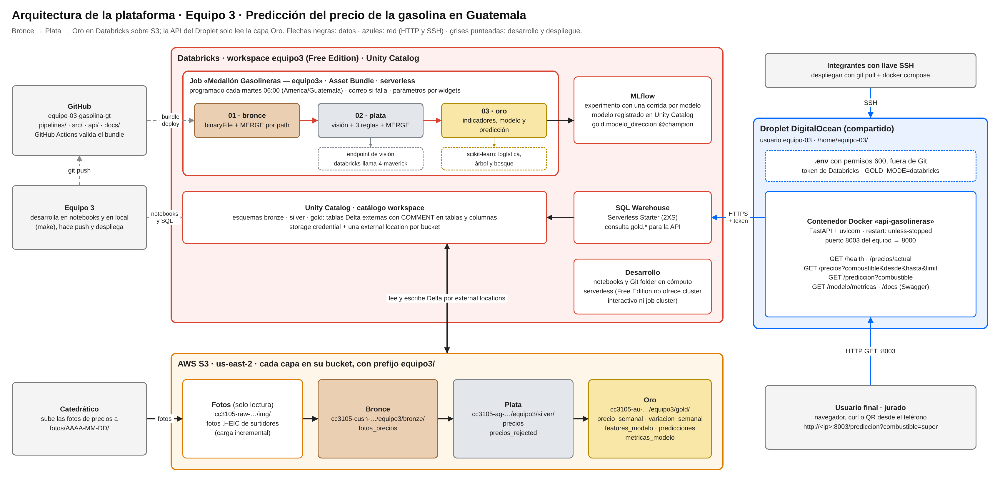

# Predicción del precio de la gasolina en Guatemala · Equipo 3

Proyecto final de CC3105 (UVG). Un pipeline de punta a punta convierte fotos de displays de surtidores en
precios limpios, calcula indicadores semanales y predice si el precio de cada combustible **sube, baja o se
mantiene** la semana siguiente. Los resultados se publican en una API REST.

- **Diagrama de arquitectura:** [`docs/arquitectura.png`](docs/arquitectura.png) · fuente editable
  [`docs/arquitectura.drawio`](docs/arquitectura.drawio) (se abre en [diagrams.net](https://app.diagrams.net))
- **Informe técnico:** [`docs/informe.pdf`](docs/informe.pdf) (fuente en `docs/informe.docx`)
- **Presentación para el jurado:** [`presentacion/presentacion_jurado.html`](presentacion/presentacion_jurado.html)
  (página web animada; versión PDF en [`presentacion_jurado.pdf`](presentacion/presentacion_jurado.pdf))
  y resumen de una página [`presentacion/resumen_jurado.pdf`](presentacion/resumen_jurado.pdf)
- **API en línea:** [`http://165.22.137.8:8003`](http://165.22.137.8:8003/docs) · Swagger en `/docs`
- **Job de Databricks:** «Medallón Gasolineras — equipo3», workspace `dbc-a56ba7f1-976e`

**Integrantes:** Jose Santiago Pereira · Nancy Mazariegos · Hugo Rivas · Giovanni Santos · Alexis Mesias



## Cómo funciona

| Capa | Qué hace | Dónde vive |
|---|---|---|
| Fotos | El catedrático sube fotos `.HEIC` de surtidores Shell (solo lectura) | `s3://cc3105-raw-…/img/` |
| **Bronce** | Lee las fotos con Spark `binaryFile` y las guarda con columnas de auditoría. `MERGE` por `path`: una segunda carga no duplica fotos | `workspace.bronze.fotos_precios` → `s3://cc3105-cusn-…/equipo3/bronze/` |
| **Plata** | El endpoint de visión `databricks-llama-4-maverick` lee venta y galones; precio efectivo = venta ÷ galones. Tres reglas de calidad y cuarentena | `workspace.silver.precios`, `silver.precios_rejected` → `s3://cc3105-ag-…/equipo3/silver/` |
| **Oro** | Precio semanal (martes a lunes), variación y dirección (±Q0.10), variables, modelo y predicción | `workspace.gold.*` → `s3://cc3105-au-…/equipo3/gold/` |
| Modelo | Logística, árbol y bosque contra la línea base de persistencia, con validación temporal y MLflow | `src/model.py` → `gold.predicciones`, `gold.metricas_modelo` |
| API | FastAPI en Docker en el Droplet; lee solo Oro | `api/` |

Databricks llega a cada bucket por una *external location* de Unity Catalog. Todas las tablas Oro tienen
`COMMENT` en la tabla y en cada columna (textos en `src/config.py`).

### Reglas de calidad (Plata)

1. Precio entre Q20 y Q60 por galón (también atrapa montos ilegibles).
2. Combustible dentro del catálogo: `diesel`, `regular`, `super`, `v_power`.
3. Fecha conocida y no futura.

Las filas que fallan van a `silver.precios_rejected` con el motivo. La exactitud de la extracción se midió a mano
en 20 fotos al azar (semilla 42) con la hoja de [`pipelines/revision_fotos_hoja.py`](pipelines/revision_fotos_hoja.py):
**9 de 20 sin ningún error (45.0 %)**; los montos salieron bien en 18 de 20, pero 10 fotos de súper quedaron
asignadas a otro combustible. Detalle en [`revision_manual/resultado.md`](revision_manual/resultado.md).
El notebook [`pipelines/revision_manual_plata.py`](pipelines/revision_manual_plata.py) hace la misma revisión y
guarda el resultado en `silver.revision_manual`.

### Modelo

Se predice `direccion_siguiente` por combustible con regresión logística, árbol de decisión y bosque aleatorio
(scikit-learn, `class_weight="balanced"`). La validación es temporal: las semanas más recientes (30 %) son
prueba y además hay validación cruzada temporal de 4 cortes, que decide el modelo elegido. La línea base es
«se repite la dirección de la semana anterior». Cada corrida queda en MLflow
(`/Shared/equipo3_gasolina_direccion`) y el modelo elegido se registra como `workspace.gold.modelo_direccion`
con el alias `@champion`. Los resultados y sus limitaciones están en la sección 4 del informe.

## Estructura del repositorio

```
├── README.md
├── databricks.yml               # Asset Bundle: Job de 3 tareas, programación y alertas (destinos dev y prod)
├── databricks/run_stage.py      # notebook que ejecuta una etapa (bronce | plata | oro) según el widget `stage`
├── src/                         # lógica del pipeline, la misma en local y en Databricks
│   ├── extract.py               #   Bronce
│   ├── vision.py, transform.py  #   Plata: lectura con visión y reglas de calidad
│   ├── load.py                  #   Oro: indicadores y variables
│   ├── model.py                 #   modelo, MLflow y predicción
│   ├── io_layer.py, config.py   #   lectura/escritura por backend y configuración
├── pipelines/
│   ├── revision_manual_plata.py # notebook de revisión manual de 20 fotos
│   └── revision_fotos_hoja.py   # genera la hoja HTML con las 20 fotos para revisarlas
├── revision_manual/             # resultado de la revisión manual (45.0 %) y correcciones
├── api/                         # API FastAPI + Dockerfile + docker-compose + .env.example
│   └── tests/consultas_api.sh   # pruebas de usuario final con curl
├── tests/                       # pytest: pipeline, modelo y revisión manual
├── scripts/descargar_oro.py     # baja las tablas Oro a CSV para entrenar en local
├── docs/                        # diagrama, informe, linaje y CRISP-DM
├── presentacion/                # diapositivas, resumen para el jurado y guion de la demo
└── .github/workflows/           # CI: valida y despliega el bundle
```

`Dockerfile` y `docker-compose.yml` de la raíz son del pipeline local del proyecto 1; su documentación quedó en
[`docs/README_proyecto1.md`](docs/README_proyecto1.md).

## Cómo reproducirlo

### 1. Requisitos

- Python 3.12+ y `make`.
- [Databricks CLI](https://docs.databricks.com/dev-tools/cli/) con un perfil para el workspace del equipo:

  ```bash
  databricks auth login --host https://dbc-a56ba7f1-976e.cloud.databricks.com --profile uvg-mlops
  ```

- Acceso a las external locations de los buckets (`xloc-raw`, `xloc-cusn`, `xloc-ag`, `xloc-au`); ver
  [`databricks/acceso_buckets.md`](databricks/acceso_buckets.md).

### 2. Desplegar y correr el Job en Databricks

```bash
databricks bundle validate -t prod -p uvg-mlops
databricks bundle deploy   -t prod -p uvg-mlops      # Job con la programación de los martes ACTIVA
databricks bundle run medallon_gasolineras -t prod -p uvg-mlops
```

- El Job tiene 3 tareas encadenadas **bronce → plata → oro**; la tarea oro recalcula las tablas, entrena el
  modelo y escribe la predicción de la semana siguiente.
- Parámetros (widgets): `stage`, `backend` (`uc` o `s3`), `team`, `vision` (`endpoint` o `json`),
  `images_dir` y `test_fraccion`. Se cambian sin tocar código, por ejemplo
  `--var="test_fraccion=0.3"`.
- Programación: cada martes a las 06:00 (America/Guatemala). Si una tarea falla, llega un correo a
  `alert_email`.
- El destino `dev` (por defecto) antepone `[dev usuario]` al nombre del Job y **pausa** la programación; para
  la entrega se despliega `-t prod`.
- Cómputo: el workspace es Databricks Free Edition, que solo ofrece serverless. Las tareas corren en
  serverless (no hay cluster interactivo ni job cluster que configurar) y `pillow-heif` se instala con `%pip` en
  `run_stage.py`. La comparación de costos entre tipos de cluster está en la sección 5 del informe.

### 3. Entrenar el modelo en local (opcional)

```bash
make venv-modelo          # crea .venv-oro con pandas, scikit-learn, mlflow y databricks-sdk
make modelo-local         # baja Oro desde Databricks y entrena/predice en local (MLflow en sqlite)
make mlflow-ui            # http://127.0.0.1:5001
make modelo-databricks    # entrena en local y registra todo en el MLflow del workspace
```

### 4. Pruebas

```bash
pip install -e ".[dev]"
pytest -q                 # pipeline, modelo e idempotencia de Plata, lógica de la revisión manual
```

## API en el Droplet

Endpoints (detalle en [`api/README.md`](api/README.md) y en Swagger, `/docs`):

| Ruta | Devuelve |
|---|---|
| `GET /health` | estado del servicio y si puede leer Oro |
| `GET /precios/actual` | último precio semanal por combustible |
| `GET /precios?combustible=diesel&desde=2026-10-01&hasta=2026-11-30&limit=100` | histórico semanal con filtros |
| `GET /prediccion?combustible=super` | predicción de la semana siguiente, con la semana y su probabilidad |
| `GET /modelo/metricas` | exactitud del modelo elegido y de la línea base |

### Desplegar

En el Droplet, con la llave SSH asignada:

```bash
ssh -i <llave> equipo-03@165.22.137.8
cd /home/equipo-03
git clone https://github.com/Equipo3MLOPS/Proyecto1_Gasolineras-.git   # o git pull si ya existe
cd Proyecto1_Gasolineras-/api
cp .env.example .env && chmod 600 .env    # completar DATABRICKS_TOKEN
docker compose up -d --build              # restart: unless-stopped -> sigue corriendo al cerrar SSH
curl http://localhost:8003/health
```

Desde otra computadora: `BASE_URL=http://165.22.137.8:8003 api/tests/consultas_api.sh` consulta el precio actual y la
predicción de súper, regular y diésel.

### Por qué Docker

El Droplet es compartido entre equipos y el enunciado prohíbe instalar paquetes a nivel de sistema. Docker
aísla Python y las dependencias de la API en una imagen propia, el contenedor se reinicia solo
(`restart: unless-stopped`) y se ejecuta igual en una laptop y en el servidor. Dentro de la imagen, `uv`
instala las dependencias de forma rápida y reproducible.

### De dónde lee la API

La API solo lee la capa Oro. En el Droplet usa `GOLD_MODE=databricks`: consulta las tablas `workspace.gold.*`
por el SQL Warehouse con un token de Databricks, porque el usuario del Droplet no tiene permiso de lectura sobre
el bucket Oro. El modo `s3` (Delta con `deltalake` y credenciales de solo lectura) queda implementado para
cuando ese acceso exista, y `local` sirve para desarrollo.

## Seguridad

- Las credenciales van solo en `api/.env` del servidor, con permisos 600. El `.gitignore` excluye `.env`,
  `*.pem`, `id_rsa*` y `*.key`.
- Las llaves SSH son personales y no se suben al repositorio.
- En Databricks no hay credenciales en los notebooks: el acceso a S3 pasa por las external locations de Unity
  Catalog.
- Cada recurso usa el prefijo del equipo: `equipo3/` en S3, el usuario `equipo-03` y el puerto 8003 en el Droplet.

## CI/CD

[`.github/workflows/databricks-deploy.yml`](.github/workflows/databricks-deploy.yml) valida el bundle en cada
pull request y lo despliega con cada push a `main`. Necesita los secrets `DATABRICKS_HOST` y `DATABRICKS_TOKEN`
en el repositorio.
